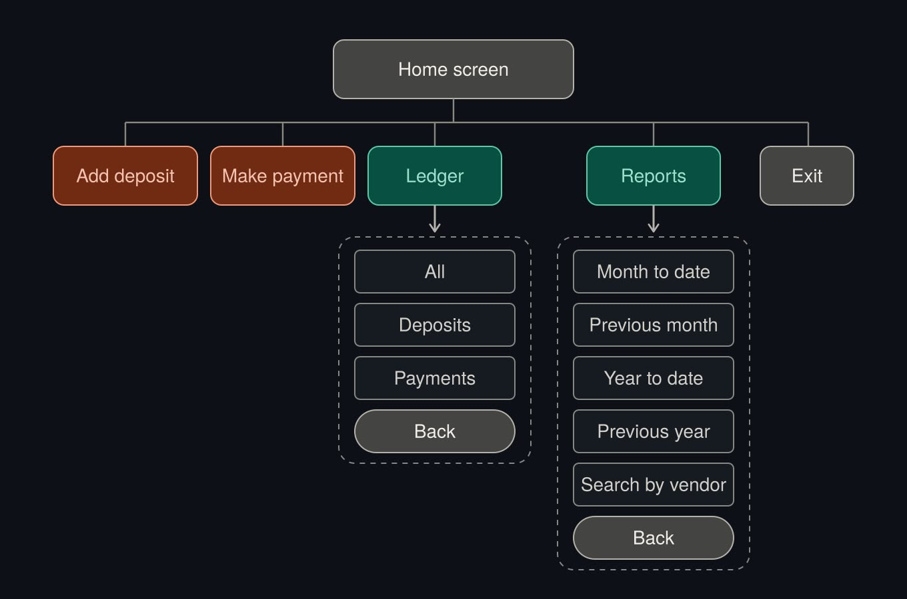
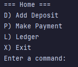
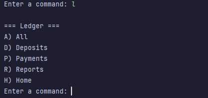
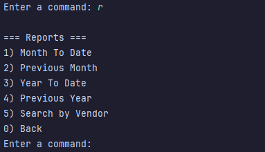
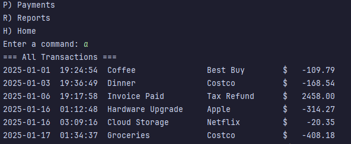
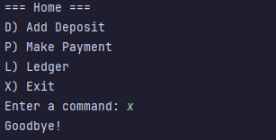

# Accounting Ledger App
A command-line app that lets you track, add, and record your financial transactions. You can write and save new 
transactions, which are categorized as either **payments** or **deposits**.

The app is designed for both personal and business use, making it easy to keep an organized record of your money in one 
place.

## Features

- Add new deposits and payments
- View all transactions saved in the file, or filter to see deposits and payments separately
- Generate reports: Month to Date, Previous Month, Year to Date, and Previous Year
- Search transactions by vendor

## How to run it
1. Clone the repository and open it in IntelliJ
2. Run `App.java`
3. The app will display a Home Menu that will ask you to prompt a command. The commands are:

`D) Add Deposit` 

`P) Make Payment`

`L) Ledger`

`X) Exit`

`Enter the command: `

Type any of the letters showed (`D, P, L, X`) on the left side of the texts in the `Enter the command: `.

**NOTE: if you type the commands in lowercase, the app will recognize your prompt.**

4. Type `L` to display the `Ledger` menu, your options will be: 

`A) All` ----> Displays the list of all the transactions made.

`D) Deposits` ----> Displays the record of all the deposits made.

`P) Payments` ----> Displays the record of all the payments made.

`R) Reports`

`H) Home`

`Enter the command: `

Type any of the letters showed (`A, D, P, R, H`) on the left side of the texts in the `Enter the command: `.

If you type `H` the app will allow you to go back to `Home` menu.

5. Type `R` to display the `Reports` menu, your options will be:

`1) Month To Date` ----> Displays the transactions of the current month.

`2) Previous Month` ----> Displays the transactions of the previous month.

`3) Year To Date` -----> Displays the transactions of the current year.

`4) Previous Year` ----> Displays the transactions of the previous year.

`5) Search by Vendor`

`0) Back` ----> Will take you back to `Ledger` screen.

`Enter the command: `

Type any of the numbers showed (`1, 2, 3, 4, 5, 0`) on the left side of the texts in the `Enter the command: `.

6. To close the app, type `0` to go back to `Ledger` screen, then type `H` to go back to `Home` menu and lastly `X` 
to `Exit` the app.

## Roadmap



## Screenshots










## Interesting Code

`displayPreviousMonth` is my interesting code. I discovered `minusMonths()` by browsing the
autocomplete options after typing a dot. It subtracts any number of months from a date, and
`minusYears()` works the same way for years, which I used later.

```java
public static void displayPreviousMonth() {
        LocalDate lastMonth = LocalDate.now().minusMonths(1);
        boolean found = false;

        System.out.println("=== Previous Year ===");

        for (Transaction transaction : transactions) {
            LocalDate time = transaction.getDate();
            if (time.getMonth() == lastMonth.getMonth() && time.getYear() == lastMonth.getYear()) {
                System.out.println(transaction);
                found = true;
            }
        }
        if (!found) {
            System.out.println("No transactions found.");
        }
        pressEnterToContinue();
    }
```

## Author

Gabriel Ponce, Year Up Java Academy

https://www.linkedin.com/in/gabriel-m-ponce/
